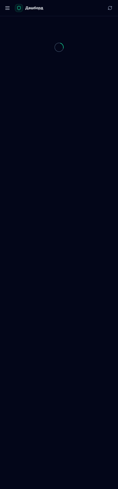

# MarkAmni WG Web Panel

**Modern Web Management Panel for AmneziaWG 3.1 / WireGuard**

[](LICENSE)
[](https://nextjs.org/)
[](https://www.typescriptlang.org/)
[](https://bun.sh/)

Современная самохостируемая веб-панель для управления VPN-серверами AmneziaWG 3.1 и WireGuard. Построена на Next.js 16, Tailwind CSS 4, TypeScript.

---

## 🇷🇺 На русском

### Возможности

- 🚀 **Полная поддержка AmneziaWG 3.1** — все параметры обфускации: `Jc`, `Jmin`, `Jmax`, `S1-S4`, `H1-H4`, `I1-I5`, `HeaderProtectionKey`, `ContentPaddingAddition`, `RekeyAfterTime` и др.
- 👥 **Управление клиентами** — создание, удаление, включение/отключение пиров, лимиты трафика и дата истечения
- 📱 **QR-коды и конфиги** — мгновенная генерация `.conf`-файлов и QR-кодов для импорта в AmneziaVPN
- 🔒 **Безопасность** — авторизация через JWT-токены, ролевая модель (root / admin)
- 🎨 **Современный UI** — тёмная тема, адаптивный дизайн, Tailwind CSS 4 + shadcn/ui
- 📊 **Дашборд и телеметрия** — CPU, RAM, диск, аптайм, график трафика в реальном времени
- 🛣️ **Маршрутизация** — полный туннель, только Россия, без локальной сети, свой список
- 🤖 **Telegram-бот** — уведомления и управление через Telegram
- 📋 **Журнал аудита** — история всех действий в панели
- 🛠 **Простая установка** — один скрипт для развёртывания

### Быстрый старт

```bash
# 1. Клонировать репозиторий
git clone https://github.com/Maarkevich/MarkAmni-WG-Web-Panel.git
cd MarkAmni-WG-Web-Panel

# 2. Установить зависимости (Bun)
bun install

# 3. Настроить окружение
cat > .env << EOF
NEXTAUTH_SECRET=замени-на-случайную-строку
NEXTAUTH_URL=http://ВАШ_IP:3080
PORT=3080
EOF

# 4. Собрать и запустить
bun run build
bun run start
```

Панель будет доступна на `http://ВАШ_IP:3080`.

**При первом запуске** панель автоматически создаёт администратора:
- Логин: `admin`
- Пароль: генерируется автоматически (см. логи или файл `.next/standalone/data/panel/initial-credentials.txt`)

### Установка через systemd (production)

```bash
cat > /etc/systemd/system/markamni-panel.service << EOF
[Unit]
Description=MarkAmni WG Web Panel
After=network.target

[Service]
Type=simple
WorkingDirectory=/opt/MarkAmni-WG-Web-Panel
Environment=NODE_ENV=production
Environment=PORT=3080
Environment=NEXTAUTH_URL=http://ВАШ_IP:3080
Environment=NEXTAUTH_SECRET=замени-на-случайную-строку
ExecStart=/root/.bun/bin/bun .next/standalone/server.js
Restart=always
RestartSec=5

[Install]
WantedBy=multi-user.target
EOF

systemctl daemon-reload
systemctl enable --now markamni-panel.service
```

---

## 🇬🇧 In English

### Features

- 🚀 **Full AmneziaWG 3.1 support** — all obfuscation params: `Jc`, `Jmin`, `Jmax`, `S1-S4`, `H1-H4`, `I1-I5`, `HeaderProtectionKey`, `ContentPaddingAddition`, `RekeyAfterTime`, etc.
- 👥 **Client management** — create, delete, enable/disable peers, traffic limits and expiry dates
- 📱 **QR codes & configs** — instant `.conf` file and QR code generation for AmneziaVPN import
- 🔒 **Security** — JWT-based authentication, role model (root / admin)
- 🎨 **Modern UI** — dark theme, responsive design, Tailwind CSS 4 + shadcn/ui
- 📊 **Dashboard & telemetry** — CPU, RAM, disk, uptime, real-time traffic chart
- 🛣️ **Routing** — full tunnel, Russia-only, no-local, custom IP list
- 🤖 **Telegram bot** — notifications and management via Telegram
- 📋 **Audit log** — full history of panel actions
- 🛠 **Easy setup** — single script deployment

### Quick Start

```bash
# 1. Clone repository
git clone https://github.com/Maarkevich/MarkAmni-WG-Web-Panel.git
cd MarkAmni-WG-Web-Panel

# 2. Install dependencies (Bun)
bun install

# 3. Configure environment
cat > .env << EOF
NEXTAUTH_SECRET=replace-with-random-string
NEXTAUTH_URL=http://YOUR_IP:3080
PORT=3080
EOF

# 4. Build and run
bun run build
bun run start
```

Panel will be available at `http://YOUR_IP:3080`.

**On first launch**, the panel automatically creates an admin user:
- Username: `admin`
- Password: auto-generated (check logs or `.next/standalone/data/panel/initial-credentials.txt`)

### Production setup with systemd

```bash
cat > /etc/systemd/system/markamni-panel.service << EOF
[Unit]
Description=MarkAmni WG Web Panel
After=network.target

[Service]
Type=simple
WorkingDirectory=/opt/MarkAmni-WG-Web-Panel
Environment=NODE_ENV=production
Environment=PORT=3080
Environment=NEXTAUTH_URL=http://YOUR_IP:3080
Environment=NEXTAUTH_SECRET=replace-with-random-string
ExecStart=/root/.bun/bin/bun .next/standalone/server.js
Restart=always
RestartSec=5

[Install]
WantedBy=multi-user.target
EOF

systemctl daemon-reload
systemctl enable --now markamni-panel.service
```

---

## 📸 Screenshots

### Dashboard


---

## 🛠 Tech Stack

| Component | Technology |
|-----------|-----------|
| Framework | Next.js 16 (App Router) |
| Language | TypeScript 5 |
| Styling | Tailwind CSS 4 + shadcn/ui |
| Auth | JWT tokens (custom) |
| Runtime | Bun 1.4 / Node.js 20 |
| VPN | AmneziaWG 3.1 / WireGuard |
| Storage | JSON file-based (no external DB required) |
| Charts | Recharts |
| Forms | React Hook Form + Zod |

---

## 🔑 API Endpoints

| Method | Endpoint | Description |
|--------|----------|-------------|
| POST | `/api/auth/login` | Login |
| POST | `/api/auth/logout` | Logout |
| GET | `/api/me` | Current user |
| GET | `/api/state` | Server state |
| GET | `/api/dashboard` | Dashboard telemetry |
| GET | `/api/clients` | List clients |
| POST | `/api/clients` | Create client |
| DELETE | `/api/clients/:id` | Delete client |
| GET | `/api/clients/:id/export` | Export client config + QR |
| POST | `/api/server/apply` | Apply server config |
| GET | `/api/logs` | Audit log |

---

## 📝 License

MIT License — see [LICENSE](LICENSE) for details.

---

## 🤝 Contributing

Contributions are welcome! Please feel free to submit a Pull Request.

---

**Made with ❤️ by [Maarkevich](https://github.com/Maarkevich)**
